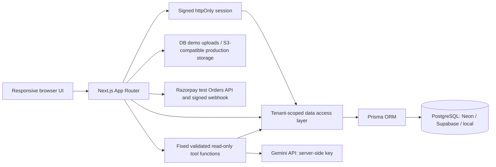

# Dukaan

Dukaan is a multi-tenant, no-code store builder for independent businesses. Storefronts are available immediately at `/s/{slug}`; owners manage catalogues, orders, themes, and content from `/admin`.

## Run locally

1. Install Node.js 20+, then copy `.env.example` to `.env`.
2. Set `AUTH_SECRET` to a random value with at least 32 characters. Set `DATABASE_URL` to PostgreSQL.
3. Run `docker compose up -d db` if using the included local database.
4. Run `npm install`, `npm run db:migrate:deploy`, `npm run db:seed`, `npm run dev`. The dev command also applies pending Prisma migrations before starting Next.js.
5. Open `http://localhost:3000`. Health check: `/api/health`.

`GEMINI_API_KEY` is optional for the rest of the app but required for AI-generated assistant answers and AI dashboard suggestions. It is read only on the server. `GEMINI_MODEL` can override the default `gemini-3.8-flash`. Checkout supports cash on delivery and an optional Razorpay **test-mode** checkout. No real payment can be collected by this configuration. Status email messages are logged as test notifications and are not sent. Logo upload is validated and stored as a database data URL for this demo. Configure S3-compatible variables before production-scale image use.

### Razorpay test checkout

1. Create or sign into a Razorpay account and switch its dashboard to **Test Mode**. Generate test API keys.
2. Set `RAZORPAY_KEY_ID` (`rzp_test_…`) and `RAZORPAY_KEY_SECRET` in `.env.local` or the deployment environment. Never expose the secret to browser code or commit it.
3. For webhook reconciliation, configure the webhook URL as `https://your-domain/api/webhooks/razorpay`, subscribe to `payment.captured` and `payment.failed`, choose a webhook secret, and set that same value as `RAZORPAY_WEBHOOK_SECRET`.
4. Enable automatic capture for test payments in Razorpay's dashboard. Restart the app, sign in as a store owner, open **Payments**, and enable **Razorpay test checkout**. COD remains available.
5. Complete a mock transaction with Razorpay's documented test credentials. The checkout amount uses the app's USD prices. The server creates the provider order, verifies the checkout signature and captured amount, updates inventory only after capture, and accepts signed webhooks as reconciliation.

This is an early demo integration using shared platform test credentials across stores. It does not onboard each store to its own Razorpay account, configure settlements/payouts, handle production-grade refunds/disputes, or support live credentials. Do not use it for real orders or money.

## Demo accounts

All seeded accounts use password `launch-demo-2026`.

| Role | Email | Store |
|---|---|---|
| Store A owner | `owner@demo.launch` | Northstar Goods (`/s/northstar-goods`) |
| Store A staff | `staff@demo.launch` | Northstar Goods |
| Store B owner | `owner@demo-b.launch` | Field Notes Market (`/s/field-notes-market`) |

Run `npm run db:seed` to seed 2 stores, 8 categories × 8 sample products in each store, and 24 orders per store distributed across the previous 60 days.

## Features mapped to checkpoints

1. Four-step onboarding has validation, back/next, local saved progress, and a progress indicator.
2. Pick from eight categories and add custom categories.
3. Category selection can populate eight polished sample products per category from the 64 item catalogue.
4. `/admin/import` supports CSV/XLSX, mapping, preview, downloadable template, duplicate and invalid-row reports; sample messy CSV is in `public/sample-messy-catalogue.csv`.
5. Four themes change layout, font, and colors and can be previewed before confirmation.
6. Unique database-enforced slugs work at `/s/{slug}`; middleware also rewrites configured subdomains.
7. Storefront includes home, category, product, search, category/price/stock filters, local cart, and COD checkout.
8. Admin dashboard shows sales, orders, product/inventory metrics, a 7-day chart, recent activity, and health score.
9. Owner settings control store identity, theme, colors, fonts, homepage sections, announcement, and footer; changes appear immediately.
10. Product manager supports CRUD, stock/pricing, discount, variants, and bulk changes.
11. Order manager updates statuses and stores a visible test-mode notification log.
12. `tenantData()` resolves membership from the session, centralizes store-scoped queries, and never accepts tenant IDs from request data. Owner/staff roles are enforced; staff cannot change store settings. Tenant predicate tests are in `tests/tenant-scope.test.ts`.
13. Store assistant answers fixed analytics questions through server-side Gemini function calls.
14. Assistant has fixed read-only functions, validated arguments, request throttling, refusal rules, and shows the raw query data used. It refuses destructive/other-store requests and unsupported data requests.
15. Wizard, storefront, and admin use responsive layouts and reusable accessible UI components.

Innovation: dashboard store-health score and data-grounded AI next actions (falls back to explicit data tips without an API key).

## Architecture

## Quality and deployment

Run `npm run lint`, `npm run typecheck`, `npm test`, and `npm run build`. The build script generates Prisma Client. GitHub Actions runs lint/typecheck/tests on pushes and pull requests to `main`; on main pushes it deploys only after those checks pass and when `VERCEL_TOKEN`, `VERCEL_ORG_ID`, `VERCEL_PROJECT_ID`, and `DATABASE_URL` repository secrets exist. It runs committed migrations before Vercel deployment. Docker Compose runs the app and PostgreSQL locally. Subdomain rewriting needs a wildcard domain on the hosting platform.

Required environment: `DATABASE_URL`, `AUTH_SECRET`. Optional AI: `GEMINI_API_KEY`, `GEMINI_MODEL`. Optional Razorpay demo: `RAZORPAY_KEY_ID`, `RAZORPAY_KEY_SECRET`, `RAZORPAY_WEBHOOK_SECRET`. Optional object storage: `S3_ENDPOINT`, `S3_REGION`, `S3_BUCKET`, `S3_ACCESS_KEY_ID`, `S3_SECRET_ACCESS_KEY`. Keep real secrets in platform environment settings; `.env` is gitignored.

## Known limitations

- Razorpay is test-mode only and uses shared platform credentials; store-specific merchant onboarding, live settlement, and production payment operations are not implemented.
- Notification status updates are visible test logs; no email provider is configured.
- Demo logo uploads use database data URLs. Production image storage needs an S3-compatible bucket and upload credentials.
- AI features require a valid Gemini API key, network access, and model availability. Without the key, assistant UI explains the configuration need and the dashboard uses non-AI data tips.
- This workspace contains no hosted database or Vercel credentials, so production deployment must be connected by the project owner.
