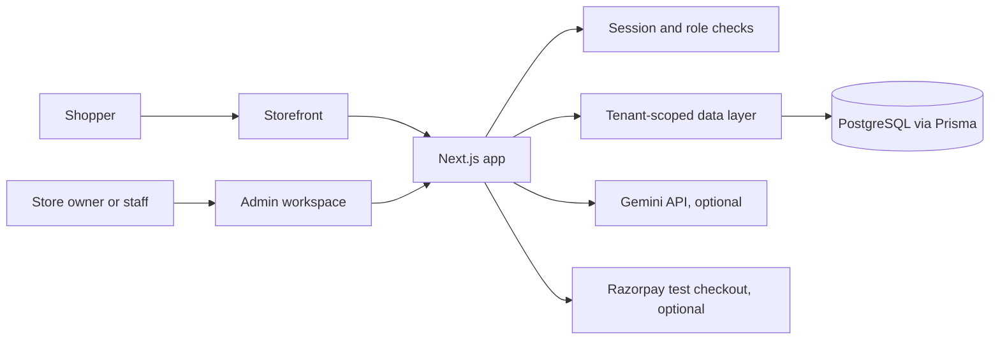

# Dukaan

**A storefront and back office for independent sellers, in one place.**

Dukaan helps a small business go from a product idea to a shareable online shop. Owners can set up a store, choose its look, add products, and manage orders without building a storefront from scratch.

> **Hackathon demo:** Dukaan is a working product prototype. Razorpay is test-mode only, email notifications are simulated, and uploaded images use demo database storage. See [Demo scope](#demo-scope) before using it with real customers or payments.

## Take a quick look

- **Landing page:** `/`
- **Live sample shop:** `/s/northstar-goods`
- **Second sample shop:** `/s/field-notes-market`
- **Create an account:** `/signup`
- **Owner workspace:** `/admin`

To explore the workspace, sign in with one of these seeded accounts. Both use the password `launch-demo-2026`.

| Role | Email | Sample store |
| --- | --- | --- |
| Owner | `owner@demo.launch` | Northstar Goods |
| Staff | `staff@demo.launch` | Northstar Goods |
| Owner | `owner@demo-b.launch` | Field Notes Market |

## What you can do

- **Create a storefront:** Follow a guided setup, choose product categories, and preview the store theme.
- **Make it yours:** Update the store name, logo, colors, fonts, announcement, homepage sections, and collection descriptions.
- **Sell products:** Browse products, search and filter the catalog, add items to a cart, and place a cash-on-delivery order.
- **Manage the day-to-day:** Create and edit products, track stock, view orders, and update order statuses from the workspace.
- **Bring in a catalog:** Import CSV or Excel files with column mapping, a preview, and duplicate or invalid-row feedback. The repository includes a [catalog import template](public/product-import-template.csv) and [messy sample file](public/sample-messy-catalogue.csv).
- **Get a store snapshot:** See sales, orders, inventory, recent activity, and a store-health score on the dashboard.
- **Ask the store assistant:** Use Gemini-powered, read-only answers for supported store analytics questions. The dashboard still provides data-based tips when Gemini is not configured.
- **Run multiple stores safely:** Store data is scoped by the signed-in user's membership and role; staff access is separate from owner settings.
- **Use it on mobile:** Store setup, storefront, and workspace adapt to smaller screens.

## Run it locally

### You’ll need

- Node.js 20 or newer
- Docker Desktop (for the included local PostgreSQL database), or another PostgreSQL database

### Start the app

1. Clone this repository and enter the project folder.
2. Copy `.env.example` to `.env`.
3. Start the local database with `docker compose up -d db`.
4. Install dependencies with `npm install`.
5. Apply database migrations and load demo data:

   ```bash
   npm run db:migrate:deploy
   npm run db:seed
   ```

6. Start the development server:

   ```bash
   npm run dev
   ```

7. Visit [http://localhost:3000](http://localhost:3000).

The development command applies pending migrations before starting Next.js. The health endpoint is `/api/health`.

### Deploy on Vercel

1. Connect the repository to Vercel and attach a hosted PostgreSQL database.
2. In **Project Settings → Environment Variables**, add `DATABASE_URL` using the database provider's connection string and `AUTH_SECRET` using a unique random value of at least 32 characters. Add both to every environment you use (Production and Preview).
3. Trigger a new deployment. Vercel uses the `vercel-build` script to apply committed Prisma migrations before building the app.
4. Confirm the deployment build succeeds, then check `/api/health`; it should report `database: connected`.

If your database provider supplies both pooled and direct URLs, use its direct connection URL for `DATABASE_URL` so Prisma migrations can run. Do not put `localhost` in Vercel's `DATABASE_URL`; that points to the Vercel build/runtime container, not your computer or hosted database.

Generate an `AUTH_SECRET` in Windows PowerShell with:

```powershell
$bytes = New-Object byte[] 32
$rng = [System.Security.Cryptography.RandomNumberGenerator]::Create()
$rng.GetBytes($bytes)
[Convert]::ToBase64String($bytes)
```

Copy the output directly into Vercel's `AUTH_SECRET` value. Keep it private and do not commit it.

### Environment variables

The minimum local configuration is in `.env.example`:

| Variable | Required? | Purpose |
| --- | --- | --- |
| `DATABASE_URL` | Yes | PostgreSQL connection string |
| `AUTH_SECRET` | Yes | Signs secure login sessions; use a unique random secret with at least 32 characters |
| `APP_URL` | For deployment | Public base URL used by the app |
| `GEMINI_API_KEY` | Optional | Enables the AI store assistant and AI dashboard suggestions |
| `GEMINI_MODEL` | Optional | Overrides the default Gemini model |
| `RAZORPAY_KEY_ID`, `RAZORPAY_KEY_SECRET` | Optional | Enables the Razorpay test checkout |
| `RAZORPAY_WEBHOOK_SECRET` | Optional | Verifies Razorpay webhook events |
| `NEXT_PUBLIC_STORE_DOMAIN` | Optional | Enables store subdomains on a domain you own |
| `S3_*` | Optional | S3-compatible storage configuration for production images |

Keep credentials in your local environment or hosting provider's secret settings. Never commit real API keys or secrets.

## How the demo fits together



The app uses Next.js App Router, React, TypeScript, Prisma, and PostgreSQL. Store-scoped data access centralizes tenant filters, while session membership and owner/staff roles control workspace access.

## Demo scope

Dukaan is intended for exploring the product flow and presenting a prototype. It is not configured for live commerce:

- **Payments:** Cash on delivery works in the demo. Razorpay integration is test-mode only and uses platform-level test credentials; it does not handle store onboarding, payouts, or production refunds and disputes. Never enter live payment credentials for this setup.
- **Notifications:** Order status messages are recorded as demo notifications; no email provider sends them.
- **Images:** Demo logo uploads are stored in the database. Use an S3-compatible image store before scaling production uploads.
- **AI:** Assistant responses require a valid Gemini API key and a supported question. Keys stay on the server. Without a key, AI features are unavailable while non-AI dashboard tips remain.
- **Custom domains:** Store URLs work on `/s/{slug}` by default. Subdomains such as `shop.yourdomain.com` require a domain you own, wildcard DNS, and matching hosting configuration.

## Checks

Run these before submitting changes:

```bash
npm run lint
npm run typecheck
npm test
npm run build
```

GitHub Actions runs lint, type checking, and tests on pushes and pull requests to `main`. The optional deployment job requires Vercel and database secrets in the repository settings.

## License

No license has been added yet. All rights are reserved unless the repository owner adds a license.
